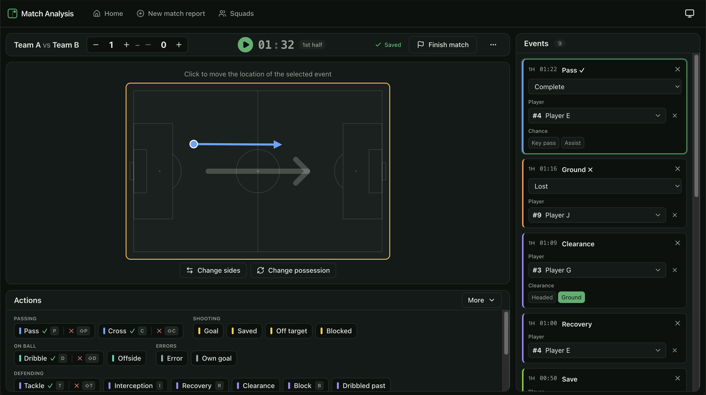
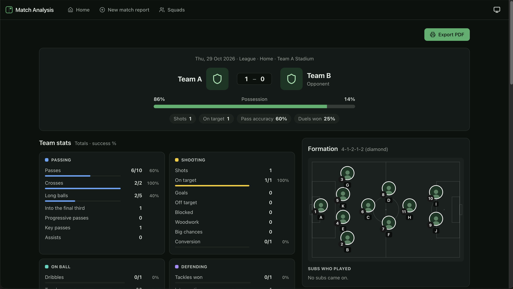
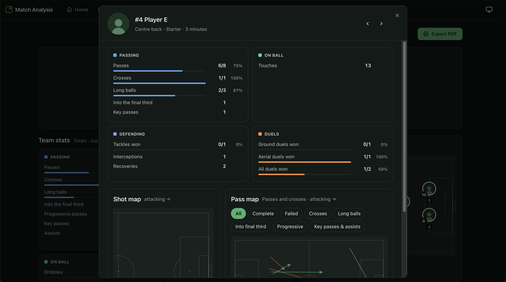
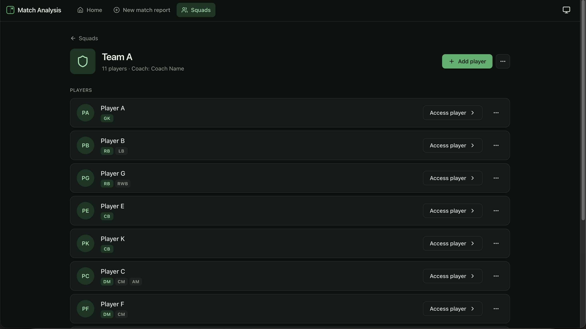

# Match Analysis

Manual collector app for football. Record every action of your team throughout a match with analysed reports (per player and team) after the match.

Local-first: everything stays in your browser. No account, no server, no tracking.



## Features

- **Collector.** Easy to use interface for collecting the data. Sync the clock to your footage and start recording. Most if not all events require mapping and player assignment for proper reports afterwards. Missing information is marked as ⚠.
- **Match report.** Score, possession, team stats by category (passing, shooting, on ball, defending, duels, fouls and cards, errors, goalkeeping), the starting formation and the subs who came on.
- **Player reports.** Each player's own stats, shot map and pass map, with filters for complete, failed, long, progressive and key passes.
- **Team PDF.** A print-ready A4 report of the match, saved through the browser's Save as PDF.
- **Squads and player profiles.** Add as many squads as you like with profiles for each of the squad's players.
- **Lineups.** Matchday squad, shirt numbers per match and 15 formations available.
- **Backups.** Export everything, or a single match, as one JSON file, and import it on any computer.

| Match report | Player report |
| --- | --- |
|  |  |



## Privacy

- All data lives in your browser's storage (IndexedDB) on your own computer.
- The app makes no network connections at all: no analytics, no embeds and no web fonts.

## Requirements

- A recent Chromium browser (Chrome, Edge, Brave). The team PDF's page layout relies on Chromium's print support.
- A screen of at least 1280 × 800.
- [Node.js](https://nodejs.org/) 22.22 or newer, 24.15 or newer, or 26 and later. pnpm comes through Corepack, which installs the exact version the project uses.

## Getting started

```sh
git clone https://github.com/kmpargkas/match-analysis.git
cd  match-analysis-app
corepack enable
pnpm install
pnpm dev
```

Then open <http://localhost:5180> in Chrome, Edge or Brave.

- Node.js 25 and later no longer include Corepack. Run `npm install -g corepack` first.
- If `corepack enable` fails with a permissions error, run the commands as `corepack pnpm install` and `corepack pnpm dev` instead.
- The port is fixed on purpose. Browser storage belongs to the address, so running the app on another port would show an empty app. If something else is already using port 5180, `pnpm dev` stops with an error; close that program first.


## Backups

Your data lives only in this browser. Clearing site data or switching browsers or computers means starting from empty. Use **Export all** on the home page regularly: it saves one JSON file with every team, player and match. **Import JSON** restores it, and offers **Keep both** when a file overlaps with what is already there.

## Development

```sh
pnpm exec playwright install chromium   # once, before the first e2e run
pnpm test   # unit tests (Vitest)
pnpm lint   # ESLint and TypeScript
pnpm e2e    # Playwright smoke test on a production build (port 5181, fresh browser profile)
```

Built with Vite, React 19, TypeScript, Tailwind CSS v4, shadcn/ui, React Router, Zustand, Dexie (IndexedDB) and Zod.

## Project structure

```
src/
  domain/     pure TypeScript: stats, clock, possession, lineups, schemas and the catalogs
  storage/    repositories over IndexedDB, JSON backup and migrations
  platform/   browser APIs: file downloads and storage persistence
  features/   one folder per page: home, squads, match-setup, collector, report, player-profile
  ui/         shared components, pitch drawings and report widgets
  i18n/       UI strings
```

Action types, positions and formations are configuration (`src/domain/catalog/*.json`), not code. Stored pitch coordinates are always normalized so that your team attacks left to right.

## License

[MIT](LICENSE)
